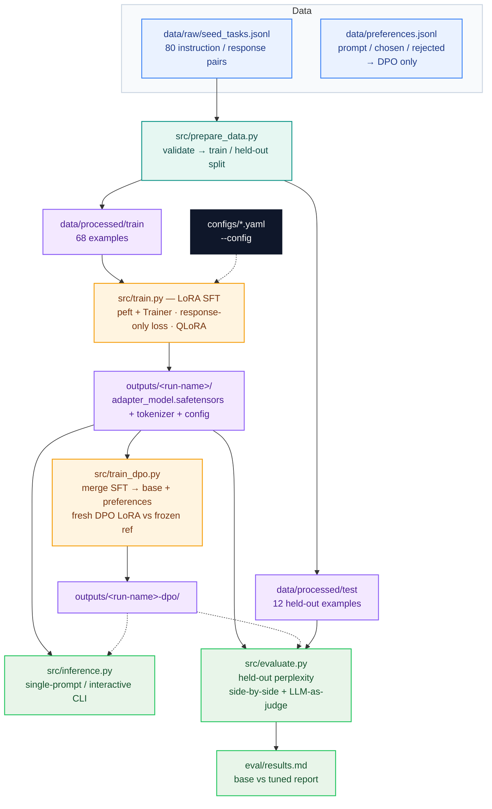

# LLM Fine-Tuning Pipeline (LoRA)

[](https://github.com/rufengma/llm-finetune-pipeline/actions/workflows/ci.yml)

A clean, end-to-end pipeline for instruction-tuning a causal language model with
**LoRA** (peft + transformers), including data preparation, training, held-out
evaluation (perplexity + side-by-side generations + optional LLM-as-judge), and
an inference CLI.

Built as a portfolio project demonstrating the full fine-tuning workflow that
AI/LLM Engineer roles ask about in interviews: data formatting, loss masking,
parameter-efficient training, and honest evaluation.

## Pipeline



## Project structure

```
llm-finetune-pipeline/
├── src/
│   ├── common.py        # prompt template, seeding, LoRA target modules, tokenization
│   ├── prepare_data.py  # JSONL → HuggingFace dataset with train/held-out split
│   ├── train.py         # LoRA fine-tuning (peft + transformers Trainer)
│   ├── train_dpo.py     # DPO preference-tuning follow-up (trl DPOTrainer)
│   ├── evaluate.py      # base vs tuned: perplexity, samples, LLM-as-judge
│   └── inference.py     # single-prompt / interactive generation CLI
├── tests/               # pytest suite (runs offline, heavy deps stubbed)
├── configs/
│   ├── recommended.yaml # reference config for a real (GPU) training run
│   ├── lr_sweep.yaml    # shared base config for a learning-rate sweep
│   └── accelerate_multi_gpu.yaml  # accelerate launch config (single node, DDP)
├── data/
│   ├── raw/seed_tasks.jsonl   # 80 hand-written instruction/response pairs
│   └── processed/             # generated by prepare_data.py (git-ignored)
│       └── manifest.json      # input/split hashes + row counts for provenance
├── eval/results.md            # generated by evaluate.py
├── .github/workflows/ci.yml  # CI: pytest + dataset prep + 10-step gpt2 smoke train
├── outputs/                   # trained adapters (git-ignored)
├── requirements.txt
├── .env.example               # optional LLM-judge credentials
└── README.md
```

## Quickstart

```bash
# 1. Install (CPU shown; for GPU install the CUDA build of torch instead)
python -m venv .venv && source .venv/bin/activate
pip install torch --index-url https://download.pytorch.org/whl/cpu
pip install -r requirements.txt

# 2. Prepare data (80 seed tasks → 68 train / 12 held-out)
python src/prepare_data.py

# 3a. Smoke test: full pipeline on CPU with gpt2 (~10 steps, a few minutes)
python src/train.py --model-id gpt2 --max-steps 10 --batch-size 2 \
    --max-seq-length 256 --output-dir outputs/smoke-test

# 3b. Real run (single ~16GB GPU)
python src/train.py --model-id Qwen/Qwen2.5-1.5B-Instruct \
    --num-epochs 3 --batch-size 2 --grad-accum 8 --lr 2e-4 --bf16 \
    --gradient-checkpointing --output-dir outputs/qwen2.5-1.5b-lora

# 3b'. QLoRA run (4-bit NF4 + double quantization, fits a 1.5B model in ~8GB
#      VRAM; needs bitsandbytes installed)
python src/train.py --model-id Qwen/Qwen2.5-1.5B-Instruct \
    --load-in-4bit --bf16 --num-epochs 3 --batch-size 2 --grad-accum 8 \
    --lr 2e-4 --gradient-checkpointing --output-dir outputs/qwen2.5-1.5b-qlora

# 3b''. Multi-GPU run (single node, DDP; needs 2+ GPUs, see below)
accelerate launch --config_file configs/accelerate_multi_gpu.yaml \
    src/train.py --config configs/recommended.yaml

# 3c. (Optional) DPO preference-tuning on top of the SFT adapter.
#     --adapter-dir merges the SFT LoRA into the base weights first, then a
#     fresh DPO LoRA is trained against a frozen reference policy.
python src/train_dpo.py --model-id Qwen/Qwen2.5-1.5B-Instruct \
    --adapter-dir outputs/qwen2.5-1.5b-lora \
    --build-from-sft --num-epochs 1 --batch-size 2 --grad-accum 4 \
    --beta 0.1 --output-dir outputs/qwen2.5-1.5b-dpo
# Or with your own preference pairs (JSONL: prompt / chosen / rejected):
python src/train_dpo.py --model-id Qwen/Qwen2.5-1.5B-Instruct \
    --dpo-data data/preferences.jsonl --output-dir outputs/qwen2.5-1.5b-dpo

# 4. Evaluate: held-out perplexity + side-by-side samples → eval/results.md
python src/evaluate.py --model-id gpt2 --adapter-dir outputs/smoke-test

#    with LLM-as-judge (needs .env, see .env.example):
python src/evaluate.py --model-id Qwen/Qwen2.5-1.5B-Instruct \
    --adapter-dir outputs/qwen2.5-1.5b-lora --judge

# 5. Inference
python src/inference.py --model-id gpt2 --adapter-dir outputs/smoke-test \
    --prompt "Explain what a REST API is."
python src/inference.py --model-id gpt2 --adapter-dir outputs/smoke-test --interactive
```

## Continuous integration

Every push and pull request runs `.github/workflows/ci.yml` on
`ubuntu-latest`: `pytest tests/ -q`, `python src/prepare_data.py`, then the
same 10-step gpt2 smoke train from Quickstart step 3a on CPU, with a final
check that `outputs/smoke-test/adapter_model.safetensors` and
`training_config.json` were actually written. No GPU or API key is needed;
the gpt2 weights are cached between runs.

## Method notes

- **Prompt format.** A simple Alpaca-style template (`### Instruction:` /
  `### Response:`) is used instead of model-specific chat templates, so the
  pipeline works with any causal LM, including GPT-2.
- **Response-only loss.** Instruction tokens are masked with `-100`, so the
  model learns to *produce* good responses rather than memorize instructions.
  This is the standard practice for instruction tuning — and a common
  interview question.
- **DPO follow-up** (`src/train_dpo.py`). After SFT, Direct Preference
  Optimization trains the model to prefer *chosen* over *rejected* responses
  relative to a frozen reference policy, with a KL penalty (`--beta`,
  default 0.1) keeping it close to the reference. The SFT LoRA is merged into
  the base weights first; a fresh DPO LoRA is then trained on top. Preference
  triples can come from a JSONL file (`--dpo-data`, columns `prompt` /
  `chosen` / `rejected`) or be derived from the SFT set for smoke tests
  (`--build-from-sft`: true response = chosen, a response to a *different*
  instruction = rejected). Note the DPO learning rate default (5e-5) is
  lower than SFT's (2e-4) — DPO is more sensitive to large updates.
- **Response-only loss.** Instruction tokens are masked with `-100`, so the
  model learns to *produce* good responses rather than memorize instructions.
  This is the standard practice for instruction tuning — and a common
  interview question.
- **Custom collator** (`make_collate_fn` in `src/common.py`) pads `labels`
  with `-100`. We avoid `DataCollatorForLanguageModeling` because in
  transformers ≥ 5 it no longer pads a precomputed `labels` field and
  overwrites it with `input_ids` when `mlm=False`, silently destroying
  response-only masking.
- **Gradient checkpointing.** `--gradient-checkpointing` (in both
  `src/train.py` and `src/train_dpo.py`) trades compute for memory: instead of
  keeping every layer's activations from the forward pass, they are recomputed
  during backprop, so activation memory grows roughly with the square root of
  the depth rather than linearly — at the cost of ~20–30% extra training time.
  Use it when *activations* (not the base weights) are what blow the VRAM
  budget: long `--max-seq-length` (default 1024), larger batch sizes, or
  models ≥ 1.5B on a 16GB card. It stacks with `--bf16` and `--load-in-4bit`.
  It is incompatible with the transformer's KV cache, which is why both scripts
  set `model.config.use_cache = False` unconditionally — the cache is only
  useful at inference time, never during training. `configs/recommended.yaml`
  already enables it (`gradient_checkpointing: true`), and the real-run
  quickstart commands pass the flag explicitly.
- **LoRA targets** are auto-detected per architecture (see `default_target_modules`
  in `src/common.py`); override with `--target-modules` if needed.
- **NEFTune.** `--neftune-noise-alpha 5.0` adds small uniform noise to the
  input embeddings during training (only the SFT script `src/train.py`;
  DPO training keeps embeddings frozen via the reference model, so the
  option isn't wired there). It's a cheap, architecture-free regularizer:
  on small instruction datasets it typically adds a point or two of
  generalization for zero extra compute. Try it when you see training
  loss drop while held-out perplexity stalls; start with `5.0` (the value
  from the paper), raise to `10–15` for very small sets.
- **Early stopping.** `--early-stopping-patience N` (only in `src/train.py`)
  evaluates on the held-out split written by `src/prepare_data.py`
  (`data/processed/test`, 12 examples; override with `--eval-split`) every
  `max_steps // 5` steps (or `--eval-steps`) for `--max-steps` runs, or once
  per epoch for `--num-epochs` runs. Training stops after N evaluation
  rounds without improvement in eval loss, and the best checkpoint is
  restored (`load_best_model_at_end`, `metric_for_best_model="eval_loss"`).
  Save cadence is aligned with eval cadence so every evaluation has a
  checkpoint to fall back to. Use it when training loss keeps dropping but
  you suspect memorization; on tiny held-out sets a patience of 2–3 is
  usually enough since eval noise is high.
- **QLoRA / quantization.** `--load-in-4bit` loads the base model in 4-bit
  NF4 (with nested/double quantization, `--bnb-4bit-double-quant` on by
  default) via bitsandbytes, then trains LoRA adapters on the frozen
  4-bit weights — roughly 4× less VRAM than full-precision LoRA, so a
  1.5B-parameter model fits in ~8GB. Compute dtype follows `--bf16` /
  `--fp16` (defaults to bf16). `--load-in-8bit` keeps the older 8-bit path;
  the two flags are mutually exclusive. Both require a CUDA GPU — on CPU the
  script warns and falls back to full precision so smoke tests still run.

## LoRA hyperparameters

| Parameter | Default | Rationale |
|---|---|---|
| `r` (rank) | 16 | Sweet spot for instruction tuning: enough capacity to learn the task style without overfitting a small dataset. 8 for tiny data, 32–64 for harder tasks. |
| `lora_alpha` | 32 | Scaling factor; `alpha = 2 × r` is the widely used heuristic (effective LR multiplier `alpha / r = 2`). |
| `lora_dropout` | 0.05 | Light regularization on the adapter; small datasets overfit quickly without it. |
| target modules | auto | Attention projections (+ MLP for LLaMA-style models): where task adaptation happens. |
| learning rate | 2e-4 | Standard for LoRA; full fine-tuning would use ~10× less. Higher than this risks instability with small batches. |
| warmup ratio | 0.05 | Short warmup avoids early gradient spikes on the randomly initialized adapter. (Converted to `warmup_steps` internally — transformers ≥ 5 removed `warmup_ratio`.) |
| scheduler | cosine | Smooth decay to ~0; well-behaved for short fine-tuning runs. |
| batch (eff.) | 16 | `batch_size 2 × grad_accum 8`: stable gradients without much VRAM. |
| epochs | 3 | Enough for the adapter to pick up style on ~70 examples; more risks memorization. |

## Results

> **Smoke test** (CPU, `gpt2`, 10 steps, batch size 2, seq len 256) — run to verify
> the pipeline end-to-end, **not** to produce a good model. Numbers below are
> from that run:

| Metric | Base (gpt2) | LoRA-tuned | Δ |
|---|---|---|---|
| Held-out mean NLL (response tokens) | 3.6752 | 3.4998 | −0.1754 |
| Held-out perplexity | 39.46 | 33.11 | −16.1% |

Sample side-by-side generations are in [`eval/results.md`](eval/results.md).

**What to expect from a real run** (Qwen2.5-1.5B, 3 epochs, lr 2e-4, per the
recommended config): held-out perplexity should drop noticeably versus the
base model, and generations should follow the instruction/response style of
the seed data (concise, structured answers). With only 80 seed examples, treat
this as *style* tuning — for capability gains you would scale the dataset to
thousands of examples.

## LLM-as-judge (optional)

`evaluate.py --judge` compares base vs tuned responses pairwise with an
OpenAI-compatible judge model:

```bash
cp .env.example .env   # fill in JUDGE_API_KEY / JUDGE_BASE_URL / JUDGE_MODEL
```

Each pair is judged in **both orders**; a win counts only when the judge
agrees in both orderings (mitigates position bias). Works with OpenAI, vLLM,
Ollama, or any OpenAI-compatible endpoint.

## Recommended real config

See [`configs/recommended.yaml`](configs/recommended.yaml) — the equivalent
CLI invocation is step 3b above. On a single 16GB GPU (e.g. T4/L4), expect
roughly 10–20 minutes for 3 epochs on this dataset with Qwen2.5-1.5B.

`train.py` also accepts `--config <file.yaml>`: values in the file act as
defaults and any explicit CLI flag overrides them. `recommended.yaml` and
`configs/lr_sweep.yaml` are runnable this way:

```bash
python src/train.py --config configs/recommended.yaml
```

## Learning-rate sweep

See [`configs/lr_sweep.yaml`](configs/lr_sweep.yaml) — a shared base config
plus the recommended log-spaced grid (1e-5, 5e-5, 1e-4, 2e-4). Each sweep
leg reuses the config and overrides `--lr` and `--output-dir`:

```bash
for lr in 1e-5 5e-5 1e-4 2e-4; do
  python src/train.py --config configs/lr_sweep.yaml \
      --lr "$lr" --output-dir "outputs/lr-sweep-$lr"
done
```

Then compare the legs on the held-out set with `src/evaluate.py
--adapter-dir <leg>` and pick the LR with the lowest perplexity before any
longer run.

## Multi-GPU training

No code changes are needed: `train.py` uses the standard HuggingFace
`Trainer`, so `accelerate launch` drives it as-is. A ready-made single-node
DDP config ships in
[`configs/accelerate_multi_gpu.yaml`](configs/accelerate_multi_gpu.yaml)
(2 processes, `bf16` mixed precision — matching `recommended.yaml`):

```bash
nvidia-smi -L   # count your GPUs; edit num_processes in the config to match
accelerate launch --config_file configs/accelerate_multi_gpu.yaml \
    src/train.py --config configs/recommended.yaml
```

Things to know before launching:

- **Effective batch size scales with GPU count.** Effective batch =
  `batch_size × grad_accum × num_processes`, so a 2-GPU run with the
  recommended config trains on 2 × 2 × 8 = 32 examples per optimizer step
  instead of 16. Halve `--grad-accum` if you want to keep the single-GPU
  effective batch (or accept the larger batch and keep the LR — don't
  raise both at once).
- **Keep mixed precision consistent.** The config's `mixed_precision: bf16`
  matches `recommended.yaml`'s `bf16: true`. If you switch the config to
  `fp16`, switch the training config too; a mismatch makes accelerate and
  `TrainingArguments` fight over the autocast dtype.
- **Single GPU? Skip accelerate.** Plain `python src/train.py ...` (step
  3b) is the same run without the launcher overhead. `accelerate launch`
  with `num_processes: 1` also works, but buys nothing.
- **Prefer your own config?** Run `accelerate config` and answer the
  prompts (multi-GPU, bf16, no DeepSpeed/FSDP for this pipeline's size);
  it writes `default_config.yaml`, which you can pass with
  `--config_file` the same way. The shipped file is just that result,
  checked in so the setup is reproducible.
- **DPO too.** `train_dpo.py` (trl `DPOTrainer`) launches the same way —
  swap the script name in the command above.

## Weights & Biases logging (optional)

Both `train.py` and `train_dpo.py` support optional W&B run tracking --
pass `--wandb-project <project>` and train loss, LR, and the full run config
are logged to that project (via the transformers W&B integration); the
config dict from `training_config.json` / `dpo_config.json` is also attached
to the run:

```bash
pip install wandb   # only needed if you use --wandb-project
python src/train.py --config configs/recommended.yaml \
    --wandb-project llm-finetune --wandb-run-name qwen2.5-lr-2e-4
python src/train_dpo.py --build-from-sft --adapter-dir outputs/sft \
    --wandb-project llm-finetune --wandb-run-name dpo-beta-0.1
```

Without the flag (the default), nothing is logged anywhere -- `report_to`
stays `"none"`. The `wandb` package is imported lazily, so runs without the
flag don't need it installed.

## License

MIT License — see [LICENSE](LICENSE) (Copyright 2026 Rufeng Ma).
